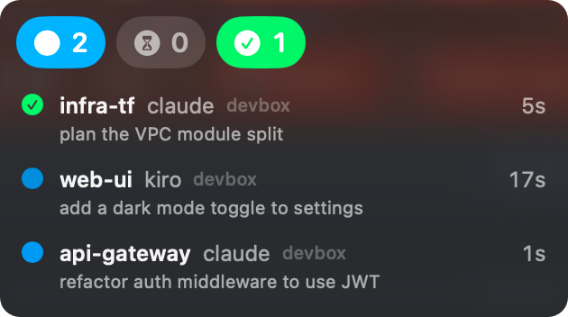
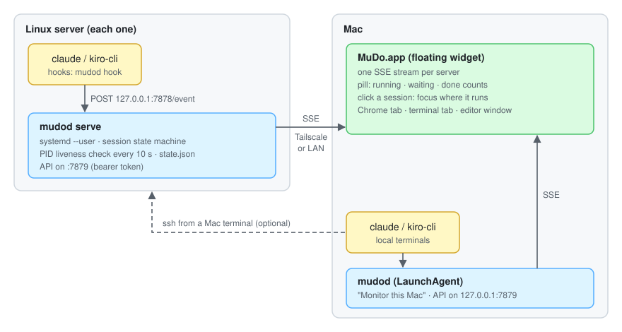
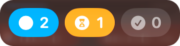
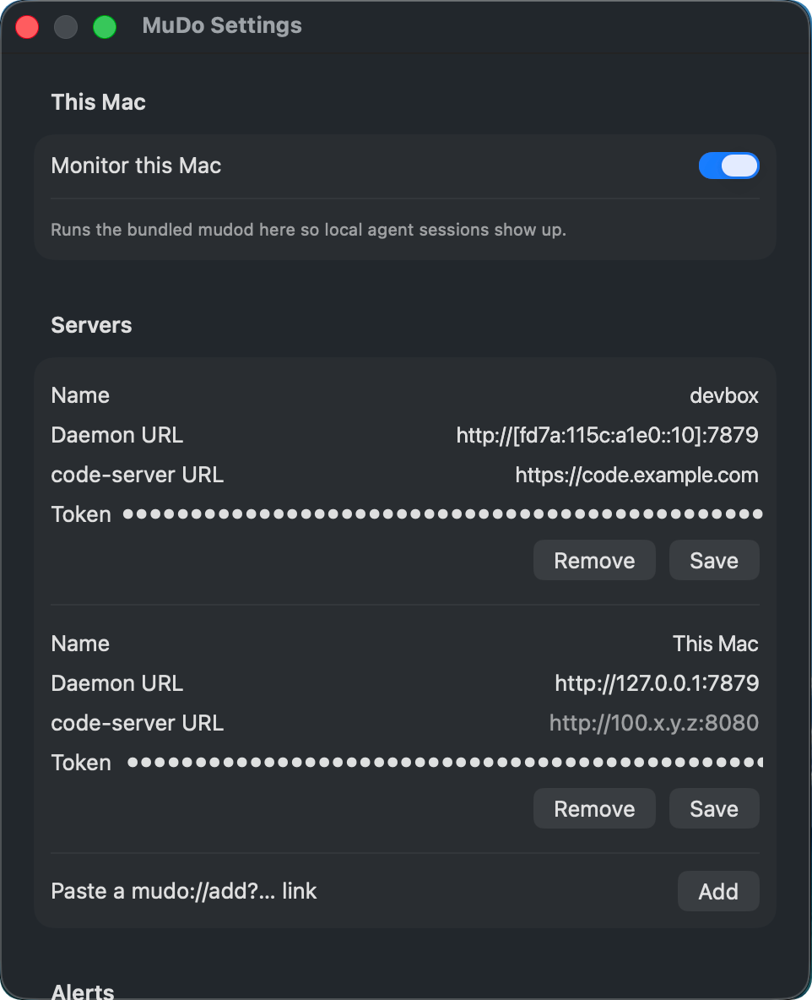

# MuDo

[](https://github.com/mvn-bachhuynh-dn/mudo/actions/workflows/ci.yml)
[](https://github.com/mvn-bachhuynh-dn/mudo/releases/latest)
[](LICENSE)

**Know which of your Claude Code and Kiro sessions need you.**

MuDo is a small always-on-top widget for macOS. Run a few coding agents in parallel, switch to something else, and MuDo shows each session as `running`, `waiting` (for a permission prompt), `done` or `idle`. A session that finished and is left unseen blinks until you look at it. Click it and MuDo brings its terminal tab, editor window or code-server tab to the front.

<p align="center"></p>

- Works on the Mac alone. Agents running on remote Linux servers (over SSH, tmux or code-server) can be added later.
- No cloud, no account, no telemetry: agent hooks report to a small local daemon, `mudod`, and the app reads it.
- Claude Code and Kiro CLI, in iTerm2, Terminal.app, Ghostty, VS Code / Cursor / Windsurf / Kiro IDE, and tmux.

## Quick start

On a Mac with Apple silicon and macOS 26 or later:

```bash
brew install --cask mvn-bachhuynh-dn/tap/mudo
open -a MuDo
```

Then MuDo Settings → **Monitor this Mac**. Start `claude` or `kiro-cli chat` in any terminal: the session shows up in the widget. Upgrade with `brew upgrade --cask mudo`.

<details>
<summary>Without Homebrew</summary>

1. Download `MuDo-macos-arm64.zip` from the [latest release](https://github.com/mvn-bachhuynh-dn/mudo/releases/latest), unzip it and move `MuDo.app` to `/Applications`.
2. The app is not notarized by Apple, so macOS blocks the first launch. Allow it once, either in System Settings → Privacy & Security → **Open Anyway**, or with:

   ```bash
   xattr -dr com.apple.quarantine /Applications/MuDo.app
   ```

</details>

The release app is signed ad hoc, so macOS asks again for Keychain access after each update. Building from source with a stable signing identity avoids that: see [Install: Mac app](#install-mac-app).

## Add a remote server

For agents running on a Linux server (amd64 or arm64), run this on the server as the user that runs the agents; no Go or Docker needed:

```bash
curl -fsSL https://raw.githubusercontent.com/mvn-bachhuynh-dn/mudo/main/install.sh | sh
# with a code-server URL, so clicks can focus its Chrome tab:
curl -fsSL https://raw.githubusercontent.com/mvn-bachhuynh-dn/mudo/main/install.sh | sh -s -- --code-server https://code.example.com
```

The script downloads `mudod` for the server's CPU from the latest release, checks it against `checksums.txt`, and runs `mudod install`, which prints a `mudo://add?…` link. Run it again to upgrade; `MUDO_VERSION=0.2.0` pins a version.

1. Make the API reachable from the Mac: [Install: server](#install-server), steps 3 and 4.
2. Open the `mudo://add?…` link on the Mac (`open 'mudo://add?…'`), or paste it in Settings → Servers. Use **Test** to check the connection.

Prebuilt binaries are attached to every [release](https://github.com/mvn-bachhuynh-dn/mudo/releases); what changed is in [CHANGELOG.md](CHANGELOG.md).

## How it works



Each agent session runs hooks that report to `mudod` on the same machine. On a server, `mudod` is a systemd user service; on the Mac it runs as a LaunchAgent on `127.0.0.1:7879` when **Monitor this Mac** is on, and MuDo.app adds it as one more server named `This Mac`. The app reads one event stream per `mudod`.

- `server/`: `mudod`, a single static Go binary (linux/amd64, linux/arm64 and darwin/arm64): agent hooks, daemon, installer.
- `app/`: `MuDo.app`, a SwiftUI macOS app with no third-party dependencies.
- Design specs: [docs/superpowers/specs/2026-10-14-mudo-design.md](docs/superpowers/specs/2026-10-14-mudo-design.md), [local Mac and SSH sessions](docs/superpowers/specs/2026-10-17-mudo-local-ssh-design.md).

## Install with an AI agent

Paste this prompt into Claude Code, Kiro or another coding agent running **on the Mac** (for remote servers it needs SSH access to each one). Replace the placeholders on the first lines first.

````text
Install MuDo (https://github.com/mvn-bachhuynh-dn/mudo) for me: a macOS widget that shows
my Claude Code / Kiro CLI sessions. Follow the repo's README.md ("Quick start",
"Add a remote server", "Install: server") and stop to ask me when something below
does not hold.

Monitor agents running on this Mac: <yes/no>
Remote servers to monitor (SSH destinations, one per line, or "none"): <user@server1>
code-server URL per server (optional): <https://code.example.com or none>

Steps:
1. Check this Mac: Apple silicon and macOS 26 or later.
2. Install the app. With Homebrew: `brew install --cask mvn-bachhuynh-dn/tap/mudo`.
   Without it: download MuDo-macos-arm64.zip from the latest GitHub release
   (`gh release download -R mvn-bachhuynh-dn/mudo -p MuDo-macos-arm64.zip` or curl),
   unzip it, move MuDo.app to /Applications, and ask me before running
   `xattr -dr com.apple.quarantine /Applications/MuDo.app` (the app is not notarized).
   Then `open -a MuDo`.
3. If I want this Mac monitored, tell me to turn on MuDo Settings > This Mac >
   "Monitor this Mac" (you cannot click it for me).
4. For each remote server, run the install script over SSH:
   `ssh <server> 'curl -fsSL https://raw.githubusercontent.com/mvn-bachhuynh-dn/mudo/main/install.sh | sh -s -- [--code-server <url>]'`
   - If it fails with "Failed to connect to bus", or warns about lingering, show me the
     `sudo loginctl enable-linger` command from the output and wait for me to run it,
     then retry with `XDG_RUNTIME_DIR=/run/user/$(id -u) ~/.local/bin/mudod install`.
   - Keep the printed `mudo://add?...` link. It contains a secret token: do not paste it
     into chats, issues or commits.
   - Check that this Mac reaches the server's API:
     `curl -s -o /dev/null -w '%{http_code}' <daemon url from the link>/v1/health` gives 401.
     If not, read README "Install: server" step 4 (api_addr, firewall) and propose the
     change; ask me before editing the firewall or anything that needs sudo.
   - Add it: `open '<mudo://add link>'`. macOS asks Keychain access: tell me to click
     "Always Allow".
5. Verify: send a prompt in an agent session (on this Mac or a server) and check that it
   appears in the MuDo widget. Report what you installed, where, and anything left for me.
````

The agent only runs what the README describes; anything with `sudo`, the firewall, Gatekeeper or a macOS permission prompt is left for you.

## Requirements

**Server**

- Linux (amd64 or arm64) with a systemd user session (lingering enabled so the daemon survives logout).
- Claude Code and/or `kiro-cli`.
- Optional: code-server opened in Google Chrome, one window per project, so clicking a session can focus it.

**Mac**

- macOS 26 or later.
- Xcode 26, only to build the app from source.
- Google Chrome (for focusing code-server tabs).
- Optional, for local and SSH sessions: iTerm2, Terminal.app, Ghostty 1.3+, or VS Code / Cursor / Windsurf / VSCodium / Kiro IDE; tmux.

**Network**: the Mac must reach the server on TCP 7879, over Tailscale or the LAN. Traffic is plain HTTP with a bearer token; use Tailscale or a trusted LAN.

## Install: server

The [install script](#add-a-remote-server) does steps 1 and 2 from a release. To build from source instead:

1. Build the binary (on any machine with Go, or with Docker: `make -C server docker-build`) and copy it to the server:

   ```bash
   cd server && make test build          # -> dist/mudod-linux-amd64
   scp dist/mudod-linux-amd64 myserver:/tmp/mudod
   ```

2. Run the installer on the server as the user that runs the agents:

   ```bash
   /tmp/mudod install --code-server https://code.example.com
   ```

   `--code-server` is optional; when given, the code-server URL is added to the printed link so the Mac app can focus Chrome tabs. `install`:

   - copies the binary to `~/.local/bin/mudod`
   - writes `~/.config/mudo/config.toml` (mode 600) with a random token and `api_addr` = `<tailscale ip -4>:7879` (`127.0.0.1:7879` with a warning if Tailscale is not available)
   - writes and starts the `mudod` systemd user service
   - merges hooks into `~/.claude/settings.json` (backup: `settings.json.mudo-bak-*`; existing hooks are kept)
   - writes `~/.kiro/hooks/mudo.json`
   - prints a `mudo://add?name=…&url=…&token=…[&code_server=…]` link for the Mac

   It is idempotent: running it again (e.g. with a newer binary) upgrades the binary and keeps the token and config.

3. If it warns that lingering is off, run the printed command so the daemon survives logout:

   ```bash
   sudo loginctl enable-linger "$USER"
   ```

   If `install` fails with `Failed to connect to bus`, the shell has no systemd user manager (common when the terminal comes from code-server running as a system service). Enable lingering as above, then:

   ```bash
   XDG_RUNTIME_DIR=/run/user/$(id -u) ~/.local/bin/mudod install
   ```

4. Make the API reachable from the Mac.
   - Listen address: `api_addr` in `~/.config/mudo/config.toml`. To listen on all interfaces (Tailscale IPv4 and IPv6, LAN), set `api_addr = "[::]:7879"` and restart: `systemctl --user restart mudod`. With a wildcard address, `mudod install` prints the link with the Tailscale IPv6 address (then IPv4, then the first LAN address).
   - Firewall, e.g. with ufw:

     ```bash
     sudo ufw allow in on tailscale0 to any port 7879 proto tcp
     sudo ufw allow in on <lan-nic> to any port 7879 proto tcp   # only if the Mac uses the LAN
     ```

5. Agents:
   - Claude Code reloads hooks on the fly; already-running sessions are picked up without a restart.
   - Kiro hooks fire only in the interactive `kiro-cli chat` TUI, not with `--no-interactive`.

Check it: `systemctl --user status mudod`, then start `claude` and send a prompt; see [server/README.md](server/README.md) for a `curl` test of the stream.

## Install: Mac app

The app bundles the darwin `mudod` (for **Monitor this Mac**). The Mac has no Go toolchain, so build that binary first on the Linux side; it lands in `app/Resources/mudod` (gitignored) and `make app` fails with a clear message without it:

```bash
make -C server app-resource      # Linux: dist/mudod-darwin-arm64 -> app/Resources/mudod
```

Then on the Mac (or from Linux with `app/scripts/on-mac`, which syncs `app/` including `Resources/mudod`):

```bash
cd app
make test                        # unit tests
scripts/make-signing-identity    # one time: stable "MuDo Dev" signing identity
make install                     # build, copy to /Applications/MuDo.app, launch
```

`scripts/make-signing-identity` creates a self-signed code-signing identity in its own keychain, so every rebuild has the same signature and macOS keeps your Keychain and Automation grants. Without it the app is signed ad-hoc and prompts again after each rebuild.

Then:

1. Open the `mudo://add?...` link printed by `mudod install` on the Mac (e.g. `open 'mudo://add?...'`), or paste it in Settings → Servers → Add. If the link has no `code_server`, fill "code-server URL" for the server in Settings and click Save.
2. First run prompts:
   - Keychain access for `dev.steve.MuDo` (the server token): click **Always Allow**.
   - Automation of Google Chrome, on the first click on a session: click **Allow**.
3. Optional: Settings → **Launch at login**.
4. Optional: Settings → This Mac → **Monitor this Mac**, to also show agents running on the Mac (see below).

### Monitor this Mac

Turning the toggle on runs the bundled `MuDo.app/Contents/Resources/mudod install --link-only` and adds the server `This Mac` (`http://127.0.0.1:7879`). That install:

- copies the binary to `~/.local/bin/mudod` (hooks keep a stable path when MuDo.app moves)
- writes `~/.config/mudo/config.toml` with `api_addr = "127.0.0.1:7879"` (an existing config is kept; a non-loopback `api_addr` gives a warning)
- writes `~/Library/LaunchAgents/dev.mudo.mudod.plist` and starts it with `launchctl` (log: `~/Library/Logs/mudod.log`)
- merges the Claude Code and Kiro hooks, as on a server

Turning it off runs `mudod uninstall` (LaunchAgent and hooks removed) and removes `This Mac` only if that succeeds; errors are shown under the toggle with the command output. When MuDo.app is updated, it re-installs `~/.local/bin/mudod` on launch if the bundled binary differs.

### Permissions

Clicks on local and SSH sessions use AppleScript. macOS asks once per app:

- Automation: Google Chrome (code-server tabs), iTerm2, Terminal, Ghostty, System Events (editor windows).
- Accessibility (System Settings → Privacy & Security → Accessibility): needed to raise the right VS Code / Cursor / Windsurf / VSCodium / Kiro window. Without it the editor is only activated.

A denied permission is logged and the click falls back to activating the app.

## Usage

**The pill** (collapsed widget):



- Chips with counts: blue = running, orange = waiting, green = done. A zero count is grey.
- The pill blinks when a session is done and unseen for longer than "Blink after N min" (default 5).
- Grey "offline" when every server is disconnected; "Add a server" when none is configured.
- Hover to expand the session list; it collapses shortly after the pointer leaves. Click the pill to pin it open (click again to unpin). Drag to move it; the position is remembered.

**A session row**: state icon, project (folder name), agent (`claude`/`kiro`), time in the current state (or `idle`), server name when several servers are configured, `?` when its server is offline (data may be outdated), ⏸ on a blinking row (snooze), and the last prompt on the second line.

- Order: waiting, blinking, done, running, idle.
- **Click a row**: marks a `done` session as seen (back to `idle`) and focuses where it runs (see [Click targets](#click-targets)). For code-server sessions, tab matching, first hit wins: the tab whose `?folder=` is the session folder, then the tab of the closest parent folder, then a tab whose title contains the project name. With no match MuDo opens a new Chrome window on `<code-server>/?folder=<cwd>`. Without a code-server URL for that server, it opens Settings.
- **Hover a blinking row**: counts as seen and snoozes it for "Snooze for N min" (default 10); ⏸ does the same.
- Below the rows, a line per server that is `offline`, `connecting…` or `token invalid`.

### Click targets

| Session runs in | Click focuses |
|---|---|
| code-server terminal on a server | the code-server tab in Chrome (unchanged) |
| local iTerm2 / Terminal.app | the exact tab/session (by TTY) |
| local Ghostty 1.3+ | the exact terminal (by TTY on 1.4+, else by a unique working-directory match) |
| local VS Code / Cursor / Windsurf / VSCodium / Kiro IDE integrated terminal | the window of that project |
| local tmux (in any of the above) | the tmux window and pane, then the terminal of a client attached to that tmux session |
| `ssh` from a local terminal tab (with or without tmux on the server) | that terminal tab |
| VS Code / Cursor Remote-SSH terminal | the local editor window of that project |

When the exact target cannot be found, the click activates the owning app; it never opens a new terminal window or tab. Warp, Alacritty, kitty and WezTerm are only activated.

**SSH sessions.** The hook on the server records `SSH_CONNECTION`; the app matches it against the Mac's established `ssh` connections (`lsof`), first by both ports, then by a single connection to that server address and port. This works over the LAN and Tailscale alike, as long as the server sees the Mac's own connection (no jump host rewriting it). Inside tmux on the server, the address of the most recently active tmux client is used. Not supported, with activation of the frontmost terminal app as fallback:

- SSH ControlMaster (multiplexed) connections: every session shares one connection, so the tab cannot be told apart.
- mosh: no TCP connection to match.

When exactly one plain `ssh` to that server is open, a click may land on that tab even if the session runs elsewhere. The tmux pane on a *remote* server is not selected.

**Menu bar item**: Settings…, Pause blinking (1 h) / Resume blinking, Allow MuDo to control Chrome… (shown only after Automation was denied), Quit MuDo.

**Settings**:



- Servers: name, daemon URL, code-server URL, token (stored in the Keychain); Save / Remove; paste a `mudo://add` link to add one. **Test** checks the values in the fields (saved or not): the daemon answers `/v1/health` and accepts the token, and the code-server URL answers HTTP.
- Alerts: Blink after N min, Snooze for N min.
- Hidden sessions: one folder pattern per line, `*` matches anything (including `/`), matched against the full session folder. Defaults: `*/kirocrew-workspace/_bg*`, `/tmp/*`.
- Launch at login.

## Troubleshooting

**The Mac can't connect (server shows "offline").**
Check that `mudod` is running (`systemctl --user status mudod`), that `api_addr` is an address the Mac can reach (`[::]:7879` listens everywhere), and that the firewall allows 7879 on `tailscale0`/the LAN NIC. Test from the Mac with `curl -H "Authorization: Bearer <token>" http://<addr>:7879/v1/health`. If the server runs Cloudflare WARP, it drops Tailscale IPv4 (`100.64.0.0/10`) traffic: use the server's Tailscale IPv6 address (`tailscale ip -6`, URL form `http://[fd7a:…]:7879`) with `api_addr = "[::]:7879"`, or the LAN address.

**"token invalid".**
The token in Settings does not match `token` in `~/.config/mudo/config.toml` on the server. Re-open the link from `mudod install` (re-running it keeps the token) or paste the token in Settings and Save.

**A session is missing.**
Check Settings → Hidden sessions. Kiro sessions started with `--no-interactive` fire no hooks and never appear. Check the hook log (below).

**Clicking a session opens a new Chrome window.**
No open Chrome tab matched (no code-server tab for that folder or a parent folder), or Automation was denied (menu: Allow MuDo to control Chrome…). See what the focuser did:

```bash
/usr/bin/log show --last 10m --info --predicate 'subsystem == "dev.steve.MuDo"'
```

To test focus without clicking (e.g. over SSH): `open 'mudo://focus?project=<name>'` (or `?session=<id>`).

**Clicking a local tmux session only activates the terminal.**
MuDo did not find `tmux`. It only runs `/opt/homebrew/bin/tmux`, `/usr/local/bin/tmux`, `~/.local/bin/tmux` or `/usr/bin/tmux` (the path the hook recorded goes first when it is one of these). Install tmux in one of those places (or link it there). A tmux socket not owned by your user is not used. Also check that a client is attached to the session; a detached session has no terminal to focus.

**Ghostty: the wrong terminal, or only activation.**
Ghostty before 1.4 exposes no TTY to AppleScript, so MuDo matches by working directory and focuses only when exactly one terminal has the session's folder. Open the session in its own folder, or update Ghostty to 1.4+.

**A VS Code sidebar Claude session is missing.**
The Claude Code extension's sidebar panel sends no hooks. Run `claude` in the editor's integrated terminal instead.

**Clicking an SSH session only activates the terminal.**
The connection could not be matched: ControlMaster, mosh, a jump host, or a session started before the hook recorded terminal info (send one prompt to refresh it). See what the focuser did with the `log show` command above (category `focus`).

**"Monitor this Mac" fails.**
The error under the toggle shows the `mudod` output. Daemon log: `~/Library/Logs/mudod.log`; service: `launchctl print gui/$(id -u)/dev.mudo.mudod`. A missing bundled binary means the app was built without `make -C server app-resource`.

**Keychain or Chrome prompts after every rebuild.**
The app is signed ad-hoc. Run `app/scripts/make-signing-identity` once, rebuild, and allow once more.

**Server-side logs.**

- Daemon: `journalctl --user -u mudod -f` (on the Mac: `~/Library/Logs/mudod.log`)
- Hook errors: `~/.local/state/mudo/hook.log`
- Raw hook payloads: set `MUDO_HOOK_DUMP=1` in the agent's environment; they are appended to `hook.log`.

## Development

```
server/   Go module for mudod (cmd/mudod, internal/...)
app/      Swift package: MuDoCore (logic, unit-tested) and MuDo (app)
docs/     design spec and implementation plans
.claude/workflows/  reusable Claude Code workflows (see below)
```

### Claude Code workflows

The repo ships [Claude Code workflows](https://code.claude.com/docs/en/workflows.md) that orchestrate subagents for the usual steps. Run them as slash commands in Claude Code:

| Command | When | What it does |
|---|---|---|
| `/mudo-spec-review docs/superpowers/specs/<file>.md` | after writing a spec, before the plan | 4 reviewers (platform feasibility, codebase fit, edge cases, security), each checked by a skeptic |
| `/mudo-task` with `{ plan, task }` | executing a plan, one task at a time | implement with TDD and commit, review spec + quality, up to 3 fix rounds |
| `/mudo-review [base]` | before merging or pushing (default base `origin/main`) | review Go, Swift, tests and public-repo safety, each finding verified by a skeptic |

```bash
cd server && make test build     # go test -race + darwin build/vet, then dist/mudod-{linux-amd64,darwin-arm64}
make -C server app-resource      # copy the darwin binary to app/Resources/mudod
cd app && make test app          # swift test, then build/MuDo.app (bundles Resources/mudod)
```

Build the Mac app from the Linux server: `app/scripts/on-mac` rsyncs `app/` to the Mac and runs a command there.

```bash
MUDO_MAC=user@my-mac app/scripts/on-mac 'make test app'
```

UI work without real agents: run a fake server that cycles scripted sessions through every state, then add `http://<host>:7879` with token `fake-token` in Settings.

```bash
mudod fake --addr 0.0.0.0:7879 --token fake-token --step 3s
```

Screenshots for the docs: `app/scripts/demo` (on the Mac) runs a separate `MuDo Demo` copy against a fake `mudod` on `127.0.0.1:7881`, leaving the real app's servers alone; `app/scripts/demo stop` removes it.

More detail: [server/README.md](server/README.md), [app/README.md](app/README.md).

### Contributing and releases

See [CONTRIBUTING.md](CONTRIBUTING.md). Commits follow [Conventional Commits](https://www.conventionalcommits.org/); [release-please](https://github.com/googleapis/release-please) turns them into a release PR that bumps `version.txt` and `CHANGELOG.md`. Merging that PR tags the release, and CI attaches `mudod-linux-amd64`, `mudod-linux-arm64`, `mudod-darwin-arm64`, `MuDo-macos-arm64.zip` and `checksums.txt`. With the `HOMEBREW_TAP_TOKEN` secret set, it also updates the cask in [homebrew-tap](https://github.com/mvn-bachhuynh-dn/homebrew-tap) from [packaging/homebrew/mudo.rb](packaging/homebrew/mudo.rb). Security reports: [SECURITY.md](SECURITY.md).

### Uninstall

- Mac: turn off Settings → **Monitor this Mac** first (removes the LaunchAgent and hooks).
- Server: `~/.local/bin/mudod uninstall` removes the systemd unit and MuDo's hooks (config, state and binary are kept; delete `~/.config/mudo`, `~/.local/state/mudo` and `~/.local/bin/mudod` to remove everything).
- Mac: `brew uninstall --cask mudo` (add `--zap` to also delete its settings), or quit MuDo and delete `/Applications/MuDo.app`.
